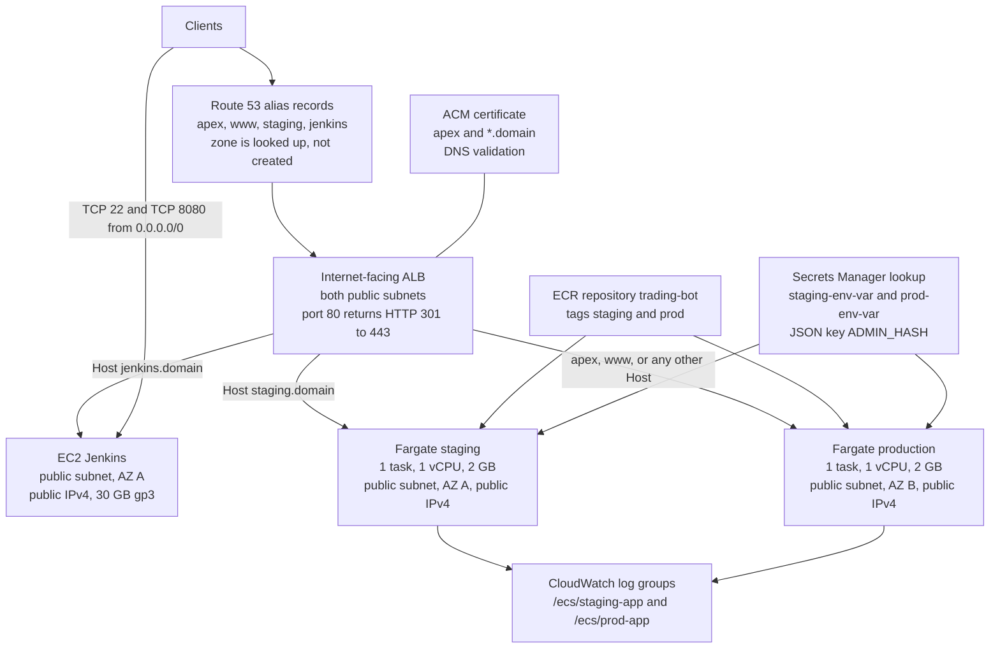
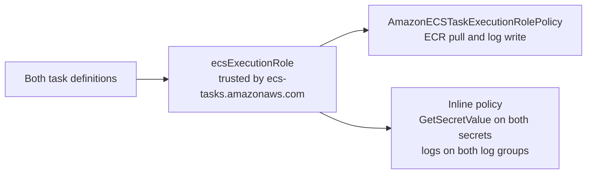

# AWS Terraform snapshot: load-balanced ECS services and Jenkins

This repository is a historical Terraform configuration for an AWS network, an internet-facing Application Load Balancer, two Amazon ECS on Fargate services, an EC2 host that bootstraps Jenkins, and the IAM, DNS, certificate, and log resources those pieces use.

It is a single-file infrastructure example. It is not a running environment, and this document does not guarantee that any hostname answers.

The defaults target `eu-west-3` and the domain name `myarbitragebot.click`. Both are variables. The Git history that contains this snapshot runs from 16 June 2025 through 3 July 2025.

## What this configuration demonstrates

`main.tf` (628 lines), `variables.tf`, `outputs.tf`, and `jenkins_user_data.sh` compose:

- a VPC with DNS support, two public subnets in two Availability Zones, and two unused private subnets
- an internet gateway and a public route table
- one shared internet-facing Application Load Balancer, with HTTP redirected to HTTPS and host-based forwarding
- an AWS Certificate Manager certificate for the apex name and a wildcard, validated by DNS records in an existing Amazon Route 53 zone
- Route 53 alias records for the apex, `www`, `staging`, and `jenkins`
- one Amazon ECR repository and two Fargate services (staging and production), each running one task
- an ECS task execution role that can pull from ECR, write to two CloudWatch log groups, and read two existing Secrets Manager secrets
- an EC2 instance in a public subnet whose user data installs Jenkins, Java 17, Docker, Maven, Git, and the AWS CLI

There is no Terraform module layout and no `backend` block. With no backend configured, Terraform uses local state.

## What is not in this repository

| Expected by the old README or by the task definitions | Present here |
| --- | --- |
| Spring Boot (or any other) application source | No |
| Dockerfile or image build | No |
| Jenkinsfile, job definition, or pipeline | No |
| Tests, Maven project, or `pom.xml` | No |
| `terraform.tfvars` (gitignored) | No |
| Remote state, lock table, or CI workflow | No |
| Autoscaling, NAT gateways, or VPC endpoints | No |

The task definitions assume a container image that listens on TCP 8080 and returns HTTP 200 from `/actuator/health`. They set `SPRING_PROFILES_ACTIVE` to `staging` or `production` and inject an environment variable named `ADMIN_HASH`. Those strings are configuration. They do not prove which application was built, or which Java version that image used.

Java 17 in this repository is the runtime the Jenkins bootstrap installs on the EC2 instance (`java-17-amazon-corretto`). It is not an application build.

The owner reports that a Spring Boot application on port 8080, and a Jenkinsfile, lived outside this snapshot and that later local edits were lost. That report matches the absence of those files. It is not something this Git history can prove on its own.

## Status

Two different kinds of statement are easy to mix up. They are kept apart here.

**Verified from this Git snapshot**

- Eleven commits, 16 June 2025 through 3 July 2025. The only tracked paths in that history are `.gitignore`, `.terraform.lock.hcl`, `README.md`, `jenkins_user_data.sh`, `main.tf`, `outputs.tf`, and `variables.tf`.
- No `terraform.tfstate`, `terraform.tfvars`, private key, Dockerfile, Java source, or Jenkinsfile appears in that history.
- The task definitions reference Secrets Manager by secret name and JSON key. They do not contain secret values. A search of these commits did not find access keys or private keys. That search covers this Git history only. It does not cover uncommitted files, a local state file after an apply, or secrets that existed in AWS.
- The AWS provider is pinned to `5.100.0` in `.terraform.lock.hcl`. The configuration itself has no `required_providers` or `required_version` block.
- Terraform plan and apply were not run for this documentation, and no AWS account was queried.

**Reported by the owner, not re-checked against AWS**

- The stack was applied around 2025, left running, then destroyed because of cost. The AWS account was closed.
- This tree is an older snapshot. Later local changes were lost.
- The hostnames below are not a live demo.

The outputs `https://jenkins.myarbitragebot.click`, `https://staging.myarbitragebot.click`, and `https://myarbitragebot.click` are strings this configuration would print. They are not evidence that DNS still resolves or that anything is deployed. This review did not call those hostnames.

## Architecture

The private subnets are omitted from the first diagram because the current services are not placed in them and no route to the internet gateway is declared for them. On 16 June 2025 both services were in those private subnets, with `assign_public_ip = false`, and they referenced the load-balancer security group. The 17 June 2025 commit moved staging to `public`, production to `public_2`, set `assign_public_ip = true`, and switched both services to the ECS security group. The private subnets remained in the file.

### Network placement

Defaults are in `variables.tf`. An apply could override them.

| Subnet | Default CIDR | Default AZ | `map_public_ip_on_launch` | Route to the internet gateway | Placed there in the current file |
| --- | --- | --- | --- | --- | --- |
| `public` | `10.0.1.0/24` | `eu-west-3a` | yes | yes | Jenkins, the staging task, and one ALB subnet |
| `public_2` | `10.0.4.0/24` | `eu-west-3b` | yes | yes | The production task, and the other ALB subnet |
| `private_staging` | `10.0.2.0/24` | `eu-west-3a` | no | no | Nothing |
| `private_prod` | `10.0.3.0/24` | `eu-west-3a` | no | no | Nothing |

The VPC CIDR default is `10.0.0.0/16`.

Allocated subnets and resilient placement are different things:

- The ALB is attached to both public subnets, so the load balancer spans two Availability Zones. An ALB requires at least two.
- Each ECS service is a single task in a single subnet. Staging is only in AZ A. Production is only in AZ B. Loss of one zone takes that environment down. There is no second task.
- Jenkins is only in the first public subnet (AZ A).
- Both private subnets use the first AZ variable, including in the original placement. They were never a multi-AZ pair. No route table association is declared for them. A subnet with no association uses the VPC main route table, and this configuration never adds a route to that table. There is no NAT gateway and no VPC endpoint. After 17 June 2025, production is the service in AZ B; staging and Jenkins stay in AZ A.

### Request path

| Listener | Behavior |
| --- | --- |
| HTTP 80 | Redirects to HTTPS 443 with status `HTTP_301`. Open to `0.0.0.0/0`. |
| HTTPS 443 | Certificate from the validated ACM certificate. Policy `ELBSecurityPolicy-TLS-1-2-2017-01`. Default action forwards to the production target group. |

Host rules on the HTTPS listener:

| Priority | Host header | Target | Target type | Health check |
| --- | --- | --- | --- | --- |
| 100 | `jenkins.<domain>` | Jenkins target group, port 8080 | instance | `GET /login`, HTTP 200 or 403 |
| 200 | `staging.<domain>` | Staging target group, port 8080 | ip | `GET /actuator/health`, HTTP 200 |
| 300 | apex and `www.<domain>` | Production target group, port 8080 | ip | `GET /actuator/health`, HTTP 200 |
| default | any other host | Production target group | ip | same as production |

All three target groups use a 30 second interval, a 5 second timeout, and thresholds of 2. A Jenkins response of 403 on `/login` is treated as healthy. Deregistration delay, stickiness, and a slow-start window are not set.

The HTTPS listener's TLS policy is TLS 1.2 only. It does not enable TLS 1.3, and its cipher set includes RSA cipher suites as well as ECDHE suites. The policy list is the AWS [security policies for an Application Load Balancer](https://docs.aws.amazon.com/elasticloadbalancing/latest/application/describe-ssl-policies.html). No TLS grade was measured from this repository.

Unmatched host names reach production. The listener does not reject them.

### Containers, registry, and logs

| | Staging | Production |
| --- | --- | --- |
| ECS service | `staging-service` | `prod-service` |
| Task family | `staging-task` | `prod-task` |
| Cluster | `trading-bot-cluster` | same cluster |
| Launch | Fargate, `awsvpc`, desired count 1 | same |
| CPU / memory | 1024 CPU units (1 vCPU) / 2048 MB | same |
| Image | `<ecr>/trading-bot:staging` | `<ecr>/trading-bot:prod` |
| Plain environment | `SPRING_PROFILES_ACTIVE=staging` | `SPRING_PROFILES_ACTIVE=production` |
| Secret | `ADMIN_HASH` from secret `staging-env-var` | `ADMIN_HASH` from secret `prod-env-var` |
| Subnet | `public` only | `public_2` only |
| Public IPv4 | `assign_public_ip = true` | `assign_public_ip = true` |
| Logs | `/ecs/staging-app`, 7 days | `/ecs/prod-app`, 30 days |

The three names `prod`, `production`, and the image tag `prod` are not interchangeable. The service and image tag use `prod`. The Spring profile value is `production`.

ECR is one repository, `trading-bot`, not two. Tag immutability, scan on push, a lifecycle policy, and a non-default encryption setting are not configured. Nothing in this repository builds or pushes either tag.

CloudWatch here is two log groups. There are no alarms, metric filters, dashboards, or container-insights settings. The log group is not `/ecs/trading-bot`.

No application autoscaling resource is declared. `desired_count` is fixed at 1. Deployment minimum and maximum percent, a circuit breaker, and `health_check_grace_period_seconds` are not set, so behavior during a rollout is whatever the ECS API supplies when those arguments are omitted. That is not a configured zero-downtime release.

An earlier commit requested 256 CPU units and 512 MB. The current file requests 1024 and 2048 for both task definitions.

### Jenkins host

The instance uses `var.instance_type` (default `t3.medium` since 1 July 2025; the earlier default was `t3.small`), a required `jenkins_ami`, and a required `key_name`. The AMI id is not pinned in Terraform. The boot script uses `yum` and was adjusted, according to its commit message, with Amazon Linux 2023 in mind. The selected AMI still has to match that assumption.

The instance is in the first public subnet, with a public IPv4 address and a 30 GB `gp3` root volume. Encryption of that volume is not set in Terraform; it follows the account default.

`jenkins_user_data.sh` installs Git, Docker, Maven, AWS CLI v2, Amazon Corretto 17, font packages, and Jenkins from the Jenkins RPM repository. It leaves the setup wizard enabled. Terraform renders the Jenkins root URL as `http://jenkins.<domain>`, not `https://`. The script does not create jobs, plugins, or credentials, and it does not configure Jenkins as a reverse proxy behind the load balancer.

The JVM options name agent port 50000. The Jenkins security group does not allow TCP 50000.

No IAM instance profile is attached. Terraform does not grant this instance permission to push to ECR or update ECS, and it does not give the AWS CLI installed at boot a role to assume.

### IAM and secret references

`ecsExecutionRole` trusts `ecs-tasks.amazonaws.com` and is attached to both task definitions as the execution role. There is no task role, so the container itself is not given an IAM role by this configuration.

The attached AWS managed policy is `AmazonECSTaskExecutionRolePolicy`. An inline policy adds:

- `secretsmanager:GetSecretValue` on both looked-up secret ARNs
- `logs:CreateLogStream` and `logs:PutLogEvents` on both log groups

One role can read both the staging secret and the production secret. The secrets are data sources named `staging-env-var` and `prod-env-var`. Terraform does not create them. Each task reads the JSON key `ADMIN_HASH` and exposes it to the container as an environment variable of the same name. This file does not contain the secret value.

### DNS and the certificate

`data.aws_route53_zone.main` looks up a public hosted zone whose name is `var.domain_name`. Terraform does not create that zone and does not register the domain.

It does create alias `A` records for the apex, `www`, `staging`, and `jenkins`, all aimed at the load balancer, with `evaluate_target_health = true`. It also creates the ACM DNS validation records. The certificate covers the apex and `*.<domain>`, with `create_before_destroy` set. This is AWS Certificate Manager, not Let's Encrypt.

### Resource boundaries

The configuration declares 41 `resource` blocks. One of them, the certificate-validation records, uses `for_each`, so the number of AWS objects depends on how many validation records ACM returns for the apex and the wildcard. Three `data` sources are reads, not creates: the hosted zone and the two secrets.

There is no count of "38 resources" in the configuration. That figure came from an older commit message and the previous README.

Deletion protection on the load balancer is set to `false`. Tagging is partial: some network and load-balancer resources carry a `Name` tag, and the log groups carry an environment tag. The ECR repository, the ECS cluster and services, the Jenkins security group, and the Route 53 records do not get a consistent tag set. The provider does not set `default_tags`.

## What an apply would depend on

This file is not an apply procedure. Plan and apply were not run, and running them would create billable resources. The configuration cannot succeed unless the following already exist, because they are required inputs or data sources rather than resources it creates:

- credentials for an AWS account, which are not stored in this repository
- `jenkins_ami` and `key_name` (no defaults). The key pair must already exist in the region. The private key is not in Git
- a Route 53 hosted zone for `domain_name`
- Secrets Manager secrets `staging-env-var` and `prod-env-var`, each with a JSON key `ADMIN_HASH`
- container images pushed to the ECR repository this stack creates, tagged `staging` and `prod`, by a build that is not in this repository
- a Jenkins job, if the EC2 host is meant to deploy anything. The bootstrap only starts Jenkins and leaves the setup wizard on

`terraform.tfvars` and `*.auto.tfvars` are gitignored. Local state files are gitignored. Neither is in the commit history. After a real apply, local state can hold resource identifiers and sensitive attributes; keeping it only on one machine is a property of this layout, not a remote-state design.

The provider region default is `eu-west-3`.

## Security limitations in this code

These are properties of the current files, not a penetration test and not a statement about a closed account.

- The Jenkins security group allows TCP 22 and TCP 8080 from `0.0.0.0/0`. SSH and the Jenkins UI are reachable on the instance public address, in addition to the HTTPS path through the load balancer. The direct path is not terminated by the certificate on the load balancer.
- The load balancer allows TCP 80 and 443 from `0.0.0.0/0`. That is what makes the sites public. Port 80 only redirects.
- The ECS security group allows TCP 8080 only from the load-balancer security group. The tasks have public IPv4 addresses, but this group does not open the application port to the internet. All three security groups allow every outbound protocol to `0.0.0.0/0`.
- Tasks and Jenkins run in public subnets. The private subnets do not host them. Moving the tasks into those private subnets, without adding a route, would also remove their path to ECR, Secrets Manager, and CloudWatch. That path is not defined here.
- Staging and production share one execution role, and that role may read both secrets.
- Jenkins has no instance profile in Terraform. Anything it did with AWS APIs would have required credentials supplied outside this configuration.
- The load balancer can be deleted; deletion protection is off. There is no AWS WAF, no load-balancer access log, and no CloudWatch alarm.
- The TLS policy is the 2017 TLS 1.2 policy described above.
- `image_tag_mutability` is not set, so tags stay mutable under the ECR default. Scan on push is not enabled here.
- The Jenkins root URL is rendered as HTTP, and the setup wizard is left on. Agent port 50000 is named in the JVM options and is not opened in the security group.

## Where the previous README and these files differ

| Previous claim | What the files show |
| --- | --- |
| Production-ready and operational | A historical desired layout. No live check was done. The owner reports that the resources were destroyed and the account closed. |
| Let's Encrypt | An ACM certificate with DNS validation in Route 53. |
| Auto-scaling and zero-downtime rolling deploys | `desired_count = 1`. No autoscaling resource. Rollout settings are not configured. |
| A Jenkins pipeline with Maven tests and a manual production approval | No Jenkinsfile and no job. The user data installs packages and starts Jenkins. |
| Tasks sized at 256 CPU and 512 MB | Current tasks are 1024 CPU units and 2048 MB. The smaller size exists only in commits before 18 June 2025. |
| ECR lifecycle policies that delete old images | No lifecycle policy. |
| CloudWatch metrics, and logs in `/ecs/trading-bot` | Two log groups, `/ecs/staging-app` and `/ecs/prod-app`. No alarms or metric filters. |
| 99.9% availability, responses under 200 ms, an SSL Labs grade, deploys in 3–5 minutes | None of these are measured or configured here. |
| Jenkins in a private subnet, path-based routing, and an IAM role that lets Jenkins push to ECR | From the first commit, Jenkins is in the public subnet, routing is by host name, and no instance profile is attached. The first README described a design the Terraform did not implement. |
| Least-privilege security groups everywhere | The ECS application port is limited to the load balancer. Jenkins SSH and port 8080 are open to the internet. On 16 June 2025 the tasks used the load-balancer security group; the 17 June commit switched them to the ECS group. |
| Private tasks moved to public subnets because they could not pull from ECR | The 17 June 2025 diff does that move and sets a public IPv4 address on each task. The diff does not record the pull failure itself. The private subnets stayed allocated, with no route. |
| An apply of 38 resources | 41 resource blocks, plus a `for_each` on certificate validation, plus three data sources. |

## Cost

If this configuration were applied in the default region and left running, the bill would be dominated by resources that stay up with or without traffic. No bill is reconstructed here. Region prices move, and several official examples on AWS pricing pages are for a different region than `eu-west-3`. Use the linked pages and the [AWS Pricing Calculator](https://calculator.aws/) for a current Paris estimate. Taxes are extra. A free tier is not assumed.

### What would drive cost

1. **Two Fargate tasks, always on.** Each service requests 1 vCPU and 2 GB, with desired count 1. Fargate charges for vCPU and memory for the life of the task, including idle time. `runtime_platform` is not set. There is no scale-to-zero and no Fargate Spot capacity provider. See [Fargate pricing](https://aws.amazon.com/fargate/pricing/).
2. **Jenkins on EC2.** One `t3.medium` by default, running continuously, plus a 30 GB `gp3` volume without extra IOPS or throughput in the configuration. The earlier default, `t3.small`, is not what the file selects now. See [EC2 on-demand pricing](https://aws.amazon.com/ec2/pricing/on-demand/) and [EBS pricing](https://aws.amazon.com/ebs/pricing/).
3. **One Application Load Balancer, shared by every hostname.** Sharing avoids paying for a load balancer per site. The hourly charge remains, and Load Balancer Capacity Units depend on connections, bytes, and rule evaluations. This HTTPS listener has a default action and three host rules. The [ELB pricing page](https://aws.amazon.com/elasticloadbalancing/pricing/) says the rule-evaluation dimension is ignored when 10 or fewer rules are processed. Connection and byte charges still depend on traffic, which this repository cannot predict. The predictable idle charge is the hourly one. Worked examples on that page use US East (N. Virginia) rates. Those rates are not a Paris quote.
4. **Public IPv4 addresses.** Jenkins requests one. Each Fargate task requests one. The load balancer uses at least one per public subnet, and it can allocate more as it scales. The [VPC pricing page](https://aws.amazon.com/vpc/pricing/), reviewed on 8 November 2026, lists an hourly charge of $0.005 for an in-use public IPv4 address. Confirm that figure for the account and region before using it. It is one line item, not a total.
5. **CloudWatch Logs.** Ingestion and storage for two groups, retained 7 days and 30 days. No alarms are defined, so alarm pricing does not apply to this configuration. Volume is not knowable from Terraform. See [CloudWatch pricing](https://aws.amazon.com/cloudwatch/pricing/).
6. **ECR storage and image transfer.** One repository, no lifecycle policy, so repeated pushes can retain old layers. This is usually small next to the always-on compute. See [ECR pricing](https://aws.amazon.com/ecr/pricing/).
7. **Route 53.** The hosted zone is a prerequisite, not a resource created here. The [Route 53 pricing page](https://aws.amazon.com/route53/pricing/), reviewed on 8 November 2026, lists $0.50 per hosted zone per month for the first 25 hosted zones, and it lists no query charge for alias A/AAAA records mapped to an Elastic Load Balancer. That is the published zone price if this zone is kept. It is not an invoice, and domain registration is separate. Registration is not in this Terraform.
8. **Secrets Manager.** The two named secrets are not created here. If they exist, they are billed by Secrets Manager. See [Secrets Manager pricing](https://aws.amazon.com/secrets-manager/pricing/).
9. **The certificate.** The [ACM pricing page](https://aws.amazon.com/certificate-manager/pricing/), reviewed on 8 November 2026, lists public non-exportable certificates used with integrated services, including an Application Load Balancer, at no cost. This configuration requests that kind of certificate. Exportable and ACME certificates have their own prices and are not requested here.
10. **Data transfer.** Internet egress and image pulls are extra and depend on traffic. They are not estimated.

### Private networking is not a current cost

No NAT gateway and no VPC endpoint are declared. NAT hourly and per-gigabyte processing charges, and interface-endpoint hourly charges, are not part of this configuration. Examples on the VPC pricing page that quote a NAT hourly rate are for US East (Ohio), not Paris.

The unused private subnets do not, by themselves, add a NAT or endpoint charge. They also do not give the tasks a private path to ECR, Secrets Manager, or CloudWatch. Adding that path would be new spend: a NAT gateway, or interface endpoints in each AZ that should keep working, plus a gateway endpoint where image layers require it. That design is not in these files.

### Tradeoffs that are not built

- Removing or stopping the two services, the Jenkins instance, and the load balancer when they are idle removes the large fixed charges and the public IPv4 addresses tied to them. The owner reports that the stack was destroyed for this reason. This repository does not contain a teardown procedure, and none was run.
- One environment instead of two removes one Fargate task and that task's public IPv4 address, and also removes that environment.
- A smaller task size lowers the Fargate charge and may be too small for a JVM. Both 0.25 vCPU / 0.5 GB and 1 vCPU / 2 GB appear in the history. The application that would decide between them is not in the repository.
- An always-on `t3.medium` build server is a fixed cost. This bootstrap does not even define a job. Starting Jenkins only when it builds would cost less. That schedule is not configured.
- A second task in the other Availability Zone, for either service, would survive the loss of one zone and would add another Fargate task and another public address. It is not declared.
- A shorter log retention or an ECR lifecycle policy would trim storage. Neither changes the always-on compute in a meaningful way.
- Closing Jenkins to a specific client range, or to the load balancer only, changes exposure. It does not remove the instance's hourly charge.

## Not in this snapshot

The following are absent. They are recorded so the scope stays clear. They are not an implementation plan, and they are not approved work.

- a remote backend and state locking
- a pipeline definition, in Jenkins or elsewhere, and the application and image build it would run
- separate execution roles per environment, a task role, and an instance profile for Jenkins
- security-group restrictions on Jenkins SSH and port 8080
- private subnets that are actually used, with NAT or VPC endpoints
- more than one task per service, a second subnet per service, or application autoscaling
- a current TLS policy, load-balancer access logs, deletion protection, or WAF
- immutable ECR tags, scan on push, and a lifecycle policy
- CloudWatch alarms
- a default listener action that does not send unknown hosts to production
- an HTTPS Jenkins root URL and a reverse-proxy setup

A change to security groups, identity, remote state, or CI needs its own review. This tree only documents the configuration as it is.
